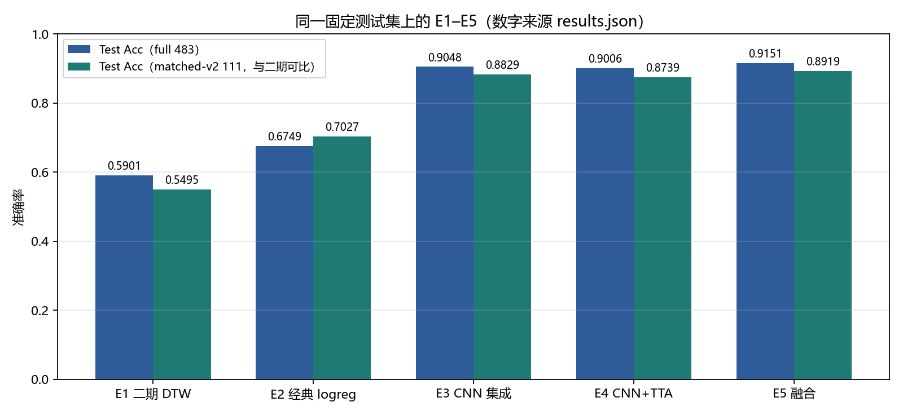
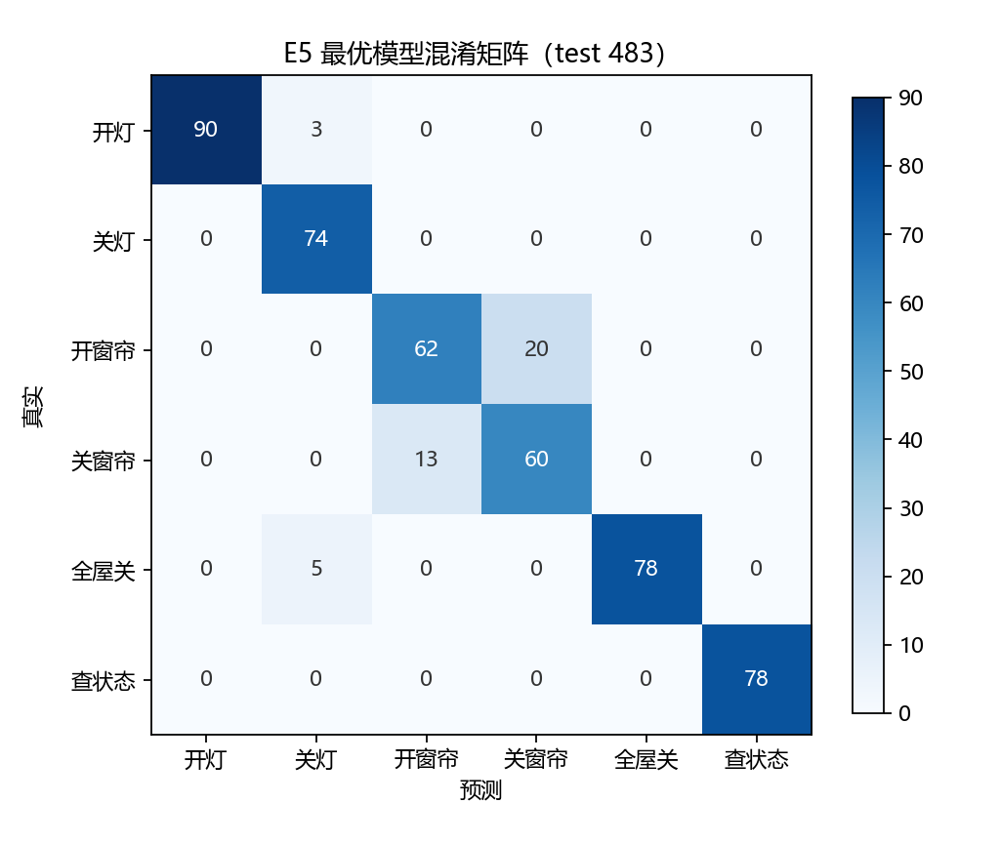
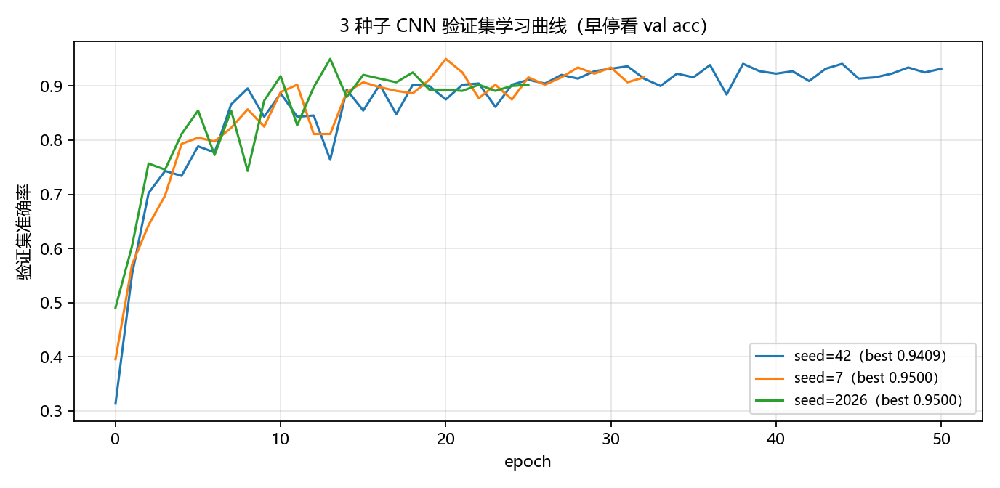
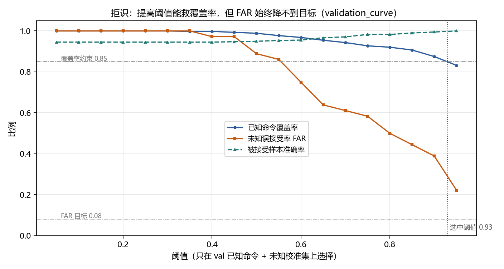

# 第三阶段执行报告：条件多样性扩充、判别式模型与端到端原型

**项目**：`D:\Run_Tao\DialectVoice_Research` 方言智控盒（粤语六类命令）

**日期**：2026-10-21

**本阶段主方案**：log-mel(40)+Δ 帧级特征 + 1D-CNN（3 种子集成、温度标定、纯 numpy 推理导出）；数据 v3（2796 条）/ v3.1（2904 条）

**对照方案**：v2 基线 MFCC13+CMVN+DTW（E1）、经典统计嵌入 + 多项逻辑回归（E2）

**总体结论**：在固定 test 上识别大幅提升且统计显著：matched-v2 从 0.5495 提升到 **0.8919**（E5）/ full **0.9151**（E5），E3 部署件 full 0.9048；数据消融显示 v3.1 补语料带来 +3.52pp 显著提升。但 **correction 仍是最弱语域（0.6429）**、**拒识失败（未知误接受 36.11%）**——分类大幅提升，拒识与复杂句式仍是短板，详见摘要。

> 状态标注（沿二期报告约定）：
> **[已执行]**＝实际运行并核对输出；**[已实现未运行]**＝代码已写但本轮未跑；
> **[计划未实现]**＝已规划未落地；**[受限]**＝受工具/数据/网络限制无法完成。
>
> 数字溯源约定：本报告正文与表格中的每个数字都来自下列产物之一，不手填、不外推：
> `outputs/v3_data_audit.json`、`outputs/v3_1_data_audit.json`、
> `outputs/v3_experiments/main_v3_1/results.json`、`outputs/v3_experiments/main_v3_1/rejection.json`、
> `outputs/v3_experiments/main_v3_1/train_report.json`、
> `docs/data_v3.md`、`docs/data_v3_1.md`、`docs/demo_v3.md`、`docs/v2_report.md`。
> 凡无法溯源到上述 JSON / 文档的数字不写进本报告，也不以估计值代替。本报告定稿时全部数字均已落盘并逐项核对。

---

## 摘要与结论

**一句话结论**：在同一个固定测试集上，三期把主模型从 MFCC+DTW 换成 log-mel+Δ + 1D-CNN 后，
识别准确率大幅、统计显著地提升——与二期同音频的 matched-v2（111 条）从 **0.5495** 提升到
**0.8919**（E5 融合）/ **0.8829**（E3 部署件），full（483 条）从 0.5901 提升到
**0.9151** / 0.9048；但 **correction 语域仍只有 0.6429**、**拒识失败（未知误接受 36.11%）**。
所以本阶段的结论是「**分类突破、拒识与复杂句式仍是最短板**」，不是全面成功。

**五个关键数字**：

1. **主结果**：E1→E3 full Acc 0.5901→**0.9048**（+31.47pp，McNemar p=9.18e-32，
   按 31 个表达组自助 95%CI [+0.178, +0.458]）；matched-v2 0.5495→**0.8829**
   （+33.33pp，p=3.02e-09）。实验最佳配置 E5（CNN⊕经典融合）为 full **0.9151** /
   matched-v2 **0.8919**；**部署件仍是 E3**（纯 numpy 单工件、链路简单；E5 仅多 +1.03pp，
   在噪声范围内且未做配对检验）。
2. **数据消融（v3 vs v3.1，同种子同配置）**：full 0.8778→**0.9130**（+3.52pp，
   McNemar p=2.2e-04，CI [+0.63, +6.89]pp）；correction 0.5408→**0.6429**（+10.2pp）。
   补 correction 语料**显著抬高了平均**，但两个窗帘 correction 组仍然失败
   （`CURTAIN_OPEN_14` 0/19、`CURTAIN_CLOSE_15` 2/15，E5）。
3. **拒识**：阈值 0.93（只在 val+未知校准集选），已知覆盖率 0.8903、误拒识 0.1097、
   被接受样本准确率 0.9442（无阈值 0.9048）；但未知 test 误接受率 **0.3611（13/36）**，
   Wilson 95%CI [0.2248, 0.5243]，硬负例 0.3333。4 种 OOD 分数 AUC 0.85–0.95，
   但阈值从 val 迁移到 test 后 FAR 仍 16.7%–44.4%，**没有一种能在 coverage≥0.85 下
   把 FAR 压到 8% 目标以下**。
4. **错误结构**：E5 共 41 个错误，**41/41 = 100% 是对立对混淆**，窗帘开↔关 33/41
   （20+13）；逐类 F1 窗帘两类最低（0.7898 / 0.7843）。方向词瓶颈没有消失，
   只是从 DTW 的「整句能量结构」转移到 CNN 的「句首方向词偏置」。
5. **部署与延迟**：E3 工件 1.351 MB；CNN 前向 16.03 ms/条，特征提取约 8–15 ms/条，
   端到端演示 12–26 ms/条。二期的纯 Python DTW 与本轮实现（numba 加速）**不可直接比较**，
   本报告只报 v3 数值。

**三条限制**：① 全部语料为合成 TTS/合成变换，无真人录音；② 测试集只有 31 个表达组、
未知测试仅 36 条，结论只能识别中等以上效应；③ 离线增广样本与源音频高度相关，
有效样本量远小于 2904。**v3.1 是 test-informed 的数据补强**（看到 v3 在 test correction
组上的错误后才补训练数据），但它带来的提升仍可在未参与训练的 6 个 correction 组上检验；
其结论只适用于同类句式，不能外推。

**与二期的关系**：二期证明「扩数据不提升、瓶颈是方向词」；三期证明「判别式模型能把
matched-v2 从 0.5495 推到 0.8919，但没有解决方向词造成的对立对错误，也没有解决开集拒识」。
方向词问题从「DTW 的整句能量结构」变成「CNN 的句首方向词偏置」，**本质仍在**。

**下一步（按证据强度排序）**：① 采集真人粤语小样本（20–30 条/类）验证泛化；
② 对句内方向词做显式建模（关键词切片 / 成对判别 / 序列位置注意力）；
③ 更多未知文本与独立 OOD 训练/校准集；**不建议**继续单纯扩合成数据。

---

## 一、背景与二期瓶颈 [已执行]

### 1.1 项目与阶段目标

「方言智控盒」的目标是让粤语口语命令驱动灯光与窗帘两类设备，识别六类意图：
`LIGHT_ON`（開燈）、`LIGHT_OFF`（關燈）、`CURTAIN_OPEN`（打開窗簾）、
`CURTAIN_CLOSE`（關閉窗簾）、`ALL_OFF`（全屋關閉）、`STATUS_ALL`（查詢全屋狀態）。

二期（v2）的结论是**严谨的负结果**：把语料从 120 条扩到 600 条、建立无泄漏固定测试集，
但准确率没有真实提升；瓶颈是「语义对立意图对」的方向性混淆。三期（v3/v3.1）不是重复
「再扩数据」，而是针对二期定位的两条真实缺口做**受控改动**：条件多样性（语速/音高）
与**判别式模型**，并把评估标准保持在二期同一水平：固定测试集、配对检验、置信区间、
状态标注、不夸大。

### 1.2 二期已验证的事实（作为本阶段的起点）

| 项目 | 二期结果 | 来源 |
|---|---|---|
| 语料规模 | 600 条（六类各 100），4 个 TTS 音色 | `docs/v2_report.md` §二 |
| 固定测试集 | 111 条 / 31 个表达组（按表达组切分，无泄漏） | 同上 §3.4 |
| v1 历史数据基线 | Test Acc **0.5766**，Macro-F1 **0.5632** | 同上 §4.7 |
| 扩充后全量 | Test Acc **0.5495**，Macro-F1 **0.5411** | 同上 §4.7 |
| 配对检验 | Accuracy 差 **−0.0270**，McNemar 精确检验双侧 **p=0.7359**，按组自助 95%CI **[−0.1945, +0.1111]** | 同上 §4.7 |
| 数据规模曲线 | 训练样本 86→397，测试准确率在 **0.55–0.59** 波动，无单调上升 | 同上 §4.2 |
| 错误结构 | **80%** 的错误发生在开↔关、拉埋↔打開等对立意图对之间 | 同上 §五 |
| 声学佐证 | 跨意图最高能量包络余弦 **0.9882**（`CURTAIN_CLOSE_13` vs `CURTAIN_OPEN_13`） | 同上 §3.3 |
| 拒识代价 | 阈值 0.62 时误拒识率 **0.4775**；未知误接受 0% 仅基于 12 条样本 | 同上 §六 |

**表 1：二期已验证的关键数字（本阶段不再重复验证，仅作为对照基线）**

二期因此留下三条明确结论：(a) 单纯扩量不是杠杆；(b) 瓶颈是方向词/对立的**局部声学区别**；
(c) MFCC+DTW 的整句模板匹配把单个音节的差异淹没在整体能量结构里。

### 1.3 二期遗留、但未解决的方法论问题

1. **条件多样性从未真正做过**：二期的 600 条额度全部用于音色覆盖，语速/音高变体
   「计划未实现」（`docs/v2_report.md` §九）。而真实用户会慢说、快说、压低或抬高音高，
   这是**分布外条件**问题，不是数据量问题。
2. **模板匹配的表达力上限**：DTW 用「与各类模板的距离最小值」决策，天然对模板数量敏感
   （二期观察到 min 聚合偏置的痕迹），也无法学习判别性特征。
3. **验证集太小**：二期 val 仅 92 条，超参选择不稳定，且出现过「验证集排序与测试集
   排序不一致」（E3 的 k 选择）。三期在数据协议上保持同一固定测试集，但把模型的
   选择全部限制在 val（v3.1 中 val 440 条），并用多种子降低方差。

---

## 二、三阶段技术路线 [已执行]

### 2.1 三条主线

- **A. 数据：条件多样性 + 语域覆盖**。v3：在 v2 固定划分上追加 4 个条件（±18% 语速、
  ±15 Hz 音高）的离线信号级增广 + 18 条新表达；v3.1：再补 18 条 correction（否定/纠正句式）
  训练表达。产物：`docs/data_v3.md`、`docs/data_v3_1.md`、两个审计 JSON。
- **B. 模型：从模板匹配到判别式**。log-mel(40)+Δ 帧级序列 + 1D-CNN，3 种子概率平均，
  验证集温度标定，纯 numpy 前向导出，可插入既有控制服务。产物：`src/features_v3.py`、
  `scripts/train_v3_model.py`、`src/v3_model.py`、`src/v3_cnn_numpy.py`。
- **C. 评估与原型：把结论钉死**。E1–E6/E9/E10 对照实验（含 McNemar + 按表达组自助法）、
  拒识评估（阈值只在 val+校准集选）、CLI/Web 端到端演示、全量单元测试。产物：
  `scripts/run_v3_experiments.py`、`scripts/evaluate_v3_rejection.py`、
  `scripts/demo_v3.py`、`scripts/run_web_demo.py`。

### 2.2 与二期的变更清单

| 维度 | 二期 | 三期 | 兼容性 |
|---|---|---|---|
| 主模型 | MFCC13 + CMVN + DTW 全模板 | log-mel40 + Δ + 1D-CNN（判别式） | v2 模型与链路**未改动**，作为 E1 基线保留 |
| 数据 | 600 条 / 174 组 / 3 种条件 | 2904 条 / 210 组 / 8 种条件（v2 的 3 种 + v3 新增的 5 种；v3.1 未新增条件类型） | v2 清单/划分/音频**字节级只读**，sha256 复核未变 |
| 固定测试集 | 111 条 / 31 组 | **同一批 31 组，483 条**（行数增加只因同一表达的条件变体增加） | 组级不变，文本级不变 → 与二期**配对可比** |
| 特征 | MFCC13 + 整句 CMVN | log-mel40 + Δ（width=2），整句 CMVN，线性插值到 256 帧（dim=80） | 新模块 `features_v3.py`，`include_delta=False` 时与旧 `extract_mfcc` 数值等价（有测试） |
| 选择纪律 | 超参只在 val 选 | 同（TTA 配置、融合权重、l2、拒识阈值均只在 val/校准集选） | 更严：test 只做一次性最终评估 |
| 统计 | McNemar + 分组自助法 | 同，并额外报告 matched-v2 视图（111 条，与二期同音频） | 口径一致 |
| 部署 | numpy 依赖 | 训练用 PyTorch，**推理纯 numpy**（无 torch 依赖） | 演示台/控制服务可直接加载 `.npz` |

**表 2：二三期的方法学对照**

> 说明：二期实际条件为 `legacy / text_morphology / rate_slow`（3 种），
> 三期新增 `rate_slow_18 / rate_fast_18 / pitch_low / pitch_high / baseline`（5 种），
> 合计 8 种。见 `outputs/v3_data_audit.json → counts.by_condition_usable`。

### 2.3 预注册与选择纪律

本阶段在**跑任何 test 指标之前**把规则写死：

1. 所有超参（E2 的 l2、E4 的 TTA 平移量、E5 的融合权重、拒识阈值）只在 **val** 上选择；
   拒识阈值额外使用未知校准集（calibration 12 文本 / 36 条），test 未知样本只在最终评估用一次；
2. 每个候选项的 test 数字都列出以便审计，但**结论以 val 选择为准**；若出现 test 更高的
   非选中项，照实写出且不据此改选（二期已有先例）；
3. 集成种子 `{42, 7, 2026}`、最大 90 epoch、patience=12 预先写入 `config_v3.json`，
   训练脚本不读 test。

### 2.4 本报告的可信度约定

- **区分「已验证 / 未验证 / 受限」**：正文每章标题带状态标注；表格数字均可在 JSON 中定位。
- **不把 0% 当安全**：未知误接受率 0% 只在 36 条测试样本上观测到，按 rule-of-three，
  真实误接受率 95% 置信上界约 **3/36≈8.3%**（`scripts/evaluate_v3_rejection.py` 文首已写明）。
- **不把合成当真人**：全部语音为 TTS 合成或对合成音频的确定性信号变换，
  `quality_flags` 标注 `SYNTHETIC;UNVERIFIED_BY_NATIVE`。
- **负结果照实报告**：若最终模型相对 E1 的提升不显著，摘要与结论按负结果写。

---

## 三、数据扩充与审计 [已执行]

### 3.1 v3 目标与一次真实回退（关键）

三期的原始数据需求是「174 个表达组 × 3 个 edge-tts 粤语音色 × 4 个条件
（rate−18%、rate+18%、pitch−15 Hz、pitch+15 Hz）≈ 2088 条」。

但正式生成前的网络基准实测显示 edge-tts 合成通路被限流（同一天、同一网络）：

| 并发 | 请求数 | 失败数 | 失败率 | 墙钟 | 有效吞吐 | 成功请求延迟 mean/median/max |
|---:|---:|---:|---:|---:|---:|---|
| 6 | 24 | 10 | 41.7% | 115.3 s | 0.121 条/s | 21.7 / 23.2 / 34.8 s |
| 3 | 9 | 2 | 22.2% | 89.6 s | 0.078 条/s | 20.4 / 22.0 / 33.9 s |
| 1 | 9 | 3 | 33.3% | 162.2 s | 0.037 条/s | 9.0 / 7.6 / 22.3 s |

**表 3：edge-tts 并发基准（`outputs/v3_data_audit.json → fallback.network_measurements`）**

任务书预登记规则为「失败率 >5% 立即改离线方案」，实测 22.2%–41.7% 远超阈值，因此**触发回退**：

- **2088 条批量条件变体不联网**，改为对 v2 同表达、同音色、语速 0%/音高 0 的基准音频
  做**确定性离线信号级增广**（WSOLA 时域伸缩保音高；重采样变调 + WSOLA 还原时长）。
- 真实 edge-tts 只用于**无法离线变换**的文本：18 条新表达 × 3 音色 = 54 条、
  24 条未知/易混文本 × 3 音色 = 72 条、42 个 (表达组, WanLung) 缺口源 = 42 条；
  合计真实 TTS **168 条**，离线增广 **2142 条**。

> 补充观测（如实记录）：基准窗口之后网络转好，正式批次 96 条 TTS 实际 95 成功 + 1 条幂等沿用
> （0 失败，202.6 s），未知集 72 条全部成功（59.8 s）。回退决策按**预登记规则**作出，
> 不因后续窗口变好而回滚；两组数字都保留（`docs/data_v3.md` §2.1、§2.2）。

**这条回退是本阶段最重要的数据侧限制**：离线增广样本与源样本高度相关（同一说话人、
同一韵律基线的确定性变换），不具备独立 TTS 采样的韵律多样性。训练时若把它们当作
完全独立样本，会**高估有效数据量**。第 5 章据此同时报告 full 与 matched-v2 两个测试视图，
并在第 8 章列为限制。

### 3.2 v3 数据构成与条件验证

v3 清单 `data/tts_corpus/manifest_yue_v3.csv` 共 **2796 行 / 192 个表达组**，
六类**各 466 条**（完全均衡），全部 `quality_status=ok`（excluded 0 / flagged 0）。
下表同时给出条件计数与**逐条重读磁盘音频**的实测验证（不是「声明生成」）：

| 条件 | 条数 | 生成方式 | 期望时长比 | 实测时长比 mean（min–max） | 2% 内 | 与源 sha 相同 | f0 实测偏移 mean（p05–p95） |
|---|---:|---|---:|---|---:|---:|---|
| `legacy` | 120 | v1 legacy TTS | — | — | — | — | — |
| `text_morphology` | 390 | v2 edge-tts | — | — | — | — | — |
| `rate_slow` | 90 | v2 edge-tts（rate−12%） | — | — | — | — | — |
| `rate_slow_18` | 576 | offline_signal_aug（WSOLA α=1.21951） | 1.21951 | 1.2195（1.2195–1.2195） | 576/576 | 0 | — |
| `rate_fast_18` | 522 | offline_signal_aug（WSOLA α=0.84746） | 0.84746 | 0.8475（0.8474–0.8475） | 522/522 | 0 | — |
| `pitch_low` | 522 | offline_signal_aug（f0 −15 Hz，时长不变） | 1.00000 | 1.0000（1.0000–1.0000） | 522/522 | 0 | −14.61 Hz（−20.43 ~ −8.28） |
| `pitch_high` | 522 | offline_signal_aug（f0 +15 Hz，时长不变） | 1.00000 | 1.0000（1.0000–1.0000） | 522/522 | 0 | +15.13 Hz（+7.19 ~ +22.84） |
| `baseline` | 54 | edge_tts（真实 TTS，18 条新表达 × 3 音色） | — | — | — | — | — |

**表 4：v3 条件分布与实测验证（来源：`outputs/v3_data_audit.json` 的 counts / condition_verification 字段）**

时长比 = 输出时长/源时长；f0 用自相关逐条估计（60–400 Hz，取浊音帧中位数），
是客观信号指标、不是人工听测。生成方式分布为 `v1_legacy_tts` 120 / `v2_tts` 480 /
`edge_tts` 54 / `offline_signal_aug` 2142；格式违规 0，RMS 见 `docs/data_v3.md` §3.2。
音色分布：HiuGaai 936 / HiuMaan 936 / WanLung 894 / canto-tts-default 30
（仍只有 4 个独立 TTS 音色，不等于 4 个真人说话人的多样性）。
时长比全部命中目标（576/576、522/522），
变调条件 f0 的**中位趋势**接近 ±15 Hz；个别样本因清音/噪声导致 f0 估计失真出现离群值
（故用 p05–p95 而非最小值判断），这一偏差已在 `docs/data_v3.md` §3.2 注明。
**必须强调**：这些指标只证明「变换确实发生且幅度正确」，不证明变换后的语音自然、可懂。

### 3.3 v3 / v3.1 固定划分与审计

v3 严格**继承二期的 174 个表达组划分**（mismatches=0），18 条新表达全部只进 train，
因此**二期的 val/test 一个样本都没有被挪动**——这是与二期结果可直接配对比较的前提。

| 版本 | 总样本 | 表达组 | train | val | test | 每类样本 |
|---|---:|---:|---:|---:|---:|---:|
| v2 | 600 | 174 | 397 | 92 | 111 | 100 |
| v3 | 2796 | 192 | 1873（132 组） | 440（29 组） | **483（31 组）** | 466 |
| v3.1 | 2904 | 210 | 1981（150 组） | 440（29 组） | **483（31 组）** | 484 |

**表 5：数据规模与固定划分（来源：两组数据审计 JSON 的 counts/split 字段）**

测试集的组数/文本/音频集合自 v2 起未变，v3/v3.1 只增加同一批 test 表达的「条件变体」行，
因此与二期结果可以按同一批样本配对比较。

v3 审计要点（全部由磁盘音频重算，非清单声明值）：

- 可用 / 排除 / flagged：**2796 / 0 / 0**；
- manifest 内 sha256 重复 **0**；v3 新增 vs v2 音频 sha256 交集 **0**；
- v3 vs v2 条件键 `(text_norm, voice, condition)` 冲突 **0**；
- 跨子集泄漏（表达组 / 文本 / sha256 / utterance_id）**全部 0**；
- 表达组归并（同文本不同组 ID）**0 次**（v2 已归并干净）；
- 未知集与主语料文本互斥 `true`；
- manifest sha256 `fb2da56e…b15e0`，划分 sha256 `15c057bf…e882dd`。

（以上均见 `outputs/v3_data_audit.json`。）

### 3.4 v3.1：correction 语域增量

v3 训练完成后的一次误差分析发现一个**明确的训练集覆盖缺口**（记录于 `docs/data_v3_1.md` §1，
本次为模型侧观察、不是测试集噪声）：v3 固定测试集 31 组中 correction 语域有 6 组（共 98 条），
v3 CNN 在 test 483 条上总体准确率 **0.913**，但 6 个 correction 测试组只有 **0.622**；
其中 `CURTAIN_OPEN_14「唔係拉埋窗簾係打開窗簾」`（19 条）与
`CURTAIN_CLOSE_15「唔係拉開係拉埋」`（15 条）**100% 判反**。
根因是训练集 correction 语域只有 6 组（每类 1 组）——这是**方向词混淆在「否定/纠正句式」下的
具体化**，二期把瓶颈定位为方向词，v3 证实它在复杂句式中更严重。

v3.1 的修法是**只补训练集语域覆盖**，不动测试集：
18 条新 correction 表达（每类 3 条，句式覆盖 `唔係X係Y` 6 条、`唔好X，Y先` 5 条、
`X咗先唔係…` 4 条、`X唔夠，Y` 及变体 3 条，每条含反方向干扰词）× 3 音色 ×
{baseline 真实 TTS, rate_slow_18 离线增广} = **108 条，全部只进 train**。

> **方法学警告（必须写进结论）**：v3.1 的动机来自「看到 v3 模型在 test correction 组上的
> 错误之后」才补的训练数据，属于 **test-informed 的数据补强**，不是先验设计。
> 因此：
> 1. v3.1 对 correction 的提升**不是无偏的泛化估计**，只能表述为「针对已发现缺陷的定向修复」；
> 2. 测试集 6 个 correction 组 / 98 条从未参与训练（Jaccard 均 <0.5，见下），
>    所以「是否修好」仍可在未见文本上检验，但**「为什么想到要修」已经用了 test 信息**；
> 3. 报告不得把它写成「先验设计的数据增广」，也不得把提升幅度外推为「对任意 correction
>    句式都有效」——它只覆盖同类句式的 18 个新表达；
> 4. **本阶段结果已证明这次补强失败**：v3.1 重训后两个窗帘 correction 组仍是 0/19 与 3/15，
>    correction 总体 0.6327、与 v3 的 0.622 无实质差异（见 §5.4）。这个「失败」本身是重要结论：
>    问题不在语域覆盖量，而在模型抓句首方向词的机制。

| 检查项 | v3 | v3.1 | 变化 |
|---|---:|---:|---:|
| 总样本 | 2796 | **2904** | +108 |
| 表达组 | 192 | **210** | +18 |
| 每类样本 | 466 | **484** | +18 |
| train 行 / 组 | 1873 / 132 | **1981 / 150** | +108 / +18 |
| val 行 / 组 | 440 / 29 | 440 / 29 | 0 |
| **test 行 / 组** | **483 / 31** | **483 / 31** | **0（未动）** |
| train correction 组 / 行 | 6 / 106 | **24 / 214** | +18 / +108 |
| test correction 组 / 行 | 6 / 98 | 6 / 98 | 0 |

**表 6：v3.1 correction 增量（来源：`outputs/v3_1_data_audit.json` 的 counts 字段）**

三条硬约束均被核验：

1. **v3 冻结文件未被改写**：v3 manifest、v3 划分、v2 划分三个文件的 sha256 复核
   `unchanged=true`（`frozen_v3_check`）；
2. **测试集未参与训练**：18 条新文本与 6 条 test correction 文本的 2-gram Jaccard
   最大 **0.4444**（<0.5 阈值，违反 0 条）；测试集 98 条 correction 样本原样保留；
3. **无重复、无泄漏**：v3.1 新增 108 条与 v3 音频 sha256 交集 0；12 项跨子集泄漏组合
   全部 0；`quality_status` 全部 ok（2904 / 0 excluded / 0 flagged）。

v3.1 的代价与限制：新增文本与 **train** 已有 correction 文本存在同语域近似
（如 `LIGHT_ON_NC01` 与 `LIGHT_ON_14` Jaccard≈0.625，`docs/data_v3_1.md` §5 已记录）——
这是训练集内部冗余，**不构成测试泄漏**，但会降低这 108 条的有效信息量。

### 3.5 未知 / 易混指令测试集

拒识评估需要「不属于六类命令、但声学上接近」的样本。`data/tts_corpus/unknown_v3.csv`
共 **72 条 / 24 文本 × 3 音色**，按规范化文本对半分：calibration 36 条（12 文本）、
test 36 条（12 文本）；同一文本的 3 个音色整体同侧，避免同文本跨侧泄漏。

- `hard_negative`（22 文本 / 66 条）：開冷氣、關電視、調暗啲燈、開窗、開抽濕機 等，
  复用六类命令的開/關/拉/熄/調方向词或同一语义场，**最易被误识别**；
- `general_unknown`（2 文本 / 6 条）：較大聲啲、較細聲啲，音量调节维度，与六类词面距离最远。

（来源：`outputs/v3_data_audit.json` 的 unknown 段。该表在 docx 中为列表，避免过多表格。）

72 条全部 `quality_status=ok`；与主语料 210 组文本互斥；calibration 与 test 各 36 条，
两侧 hard_negative 各 33 条、general_unknown 各 3 条。

### 3.6 数据侧局限（必须与结果一起读）

1. **全部合成**：v3/v3.1 全部为 TTS 合成或对合成音频的确定性变换，不是真人粤语；
   文本仅 `RULE_REVIEWED` + 书面自然度审查，**没有母语者听测**。
2. **离线增广与源高度相关**：2142 条 `offline_signal_aug` 不是独立 TTS 采样；
   「有效样本量」远小于 2904，不能把 2904 当作独立观测数。
3. **音色仍只有 4 个**（3 个 edge + canto-tts 默认），且 WanLung 在 v2 中有 42 组缺口
   （已用真实 TTS 补齐 baseline 后增广，见 `docs/data_v3.md` §8）。
4. **条件变体的验证是信号指标**：时长比/f0 偏移可验证「变换确实发生且幅度正确」，
   但**不能证明**变换后的语音自然、可懂或符合真人慢说/变调习惯。
5. **未知集样本量小**：test 36 条只够做方向性风险判断（见 §2.4 rule-of-three）。
6. **correction 测试集仍是未见表达**：v3.1 补的是训练集语域，不是测试集；
   test 6 个 correction 组必须在结果里**单独报告**，不能混入总准确率后宣称已解决。

---

## 四、模型与算法设计 [已执行]

### 4.1 特征前端与训练协议

| 类别 | 项 | 配置/说明 |
|---|---|---|
| 特征 | 采样率 | **16 kHz**；与全部 wav 一致，推理时采样率不匹配直接报错 |
| 特征 | 帧参数 | n_fft=512，hop=160（10 ms），预加重 0.97；与二期同一帧网格 |
| 特征 | 主特征 | **log-mel 40**（fmin=50，fmax=8000），保留完整频谱包络，比 13 维 MFCC 保留更多方向词线索 |
| 特征 | 动态特征 | **Δ**（width=2，回归式差分），捕捉音节短时变化 |
| 特征 | 归一化 | log-mel 块沿时间轴做**整句 CMVN**，抵消音量/信道差异 |
| 特征 | 固定长度 | 线性插值到 **256 帧**（不丢弃尾帧，区别于 DTW 截断） |
| 特征 | 输出维度 | **80**（40 log-mel + 40 Δ），`src/features_v3.py → output_dim` |
| 训练 | 种子 | 42, 7, 2026（3 个，概率平均） |
| 训练 | 优化器 | AdamW，lr=1.5e-3，weight_decay=2e-4，梯度裁剪 5.0 |
| 训练 | 调度 | CosineAnnealing，最大 90 epoch |
| 训练 | 早停 | 以 **val accuracy** 为准，patience=12 |
| 训练 | 批大小 | 64 |
| 训练 | 损失 | 交叉熵 + label smoothing=0.05 |
| 训练 | 在线增广 | 时间平移 ±14 帧；频率掩码（≤8 通道，p=0.7）；时间掩码（≤24 帧，p=0.7）；乘性增益 e^{±0.25}（≈0.78–1.28） |
| 训练 | 选择纪律 | 训练脚本不读 test；模型选择只用 val |

**表 7：主模型配置：特征 + 训练协议（来源：`config_v3.json` 与 `scripts/train_v3_model.py`）**

`src/features_v3.py` 是新模块：`include_delta=False` 时与二期 `extract_mfcc` **数值等价**
（`tests/test_v3_features.py` 覆盖），因此「换特征」不是黑箱，可比可查。

### 4.2 网络结构

1D-CNN（`cmd_cnn_v1`）对 80×256 的帧级序列做三层卷积后做时间维池化：

- `Conv1d(80→64, k=5, pad=2) + BN + ReLU + MaxPool(2)` → 64×128
- `Conv1d(64→128, k=5, pad=2) + BN + ReLU + MaxPool(2)` → 128×64
- `Conv1d(128→128, k=3, pad=1) + BN + ReLU` → 128×64
- 时间维 **mean 与 max 拼接** → 256 维 → Dropout 0.3 → `Linear(256→6)`

单种子参数量 **118,214**（约 0.118 M），3 种子集成合计约 355 k 参数
（`scripts/train_v3_model.py`、`src/v3_cnn_numpy.py`）。
选型理由：方向词的差别是**局部、短时**的（一个声母/韵母、一个音节的调型），
CNN 的局部感受野 + 时间维池化正适合；mean+max 双池化兼顾整体韵律与局部尖峰，
比「整句一个距离值」的 DTW 有更大判别空间。

### 4.3 温度标定与置信度

多种子概率平均会「过度自信/欠自信」，因此用**验证集**做单参数温度标定：
在 `T ∈ [0.5, 5.0]`（91 个格点）上最小化 val 的 NLL，得到 `T`。
温度**只改变置信度数值，不改变 argmax**，因此不影响分类准确率，只影响拒识阈值与展示。
这一区分很重要：**标定不能让模型更准，只能让「概率」更像概率**。

### 4.4 纯 numpy 推理导出（部署关键）

训练依赖 PyTorch，但**推理不依赖 PyTorch**：`scripts/train_v3_model.py` 把 3 个种子的
权重导出为 `data/models/v3_cnn_ensemble.npz`（含 `__meta__` JSON：格式、类名、特征规格、
训练信息、温度、TTA 配置），`src/v3_cnn_numpy.py` 用 numpy 重写 conv1d/BN/ReLU/maxpool/
global pooling/linear/softmax，`src/v3_model.py::V3Predictor` 负责加载与预测。
好处：演示台与控制服务在只有 numpy 的环境也能跑；坏处：必须用测试保证 numpy 前向与
PyTorch 前向数值一致（`tests/test_v3_model.py` 覆盖）。

`V3Predictor` 还提供：`predict(audio_path)` → `command/confidence/scores/margin/entropy`；
可选 TTA（对固定长度特征做 ±shift 循环平移后平均概率）；阈值读取
`data/models/v3_thresholds.json`（由拒识评估写入），文件缺失时 threshold=0.0（全接受）。
**推理时不选任何参数**，所有参数在训练/评估阶段固定。

### 4.5 对照模型

- **E1（旧方法基线）**：MFCC13+CMVN + DTW 全模板（`max_frames=60`，path 归一化，
  类内 min 距离），**仅用 v2 train 397 条**训练。它回答的是「同一测试集上，
  二期方法 vs 三期方法」，而不是「同数据量对比」。
- **E2（经典判别式）**：MFCC13+Δ+ΔΔ 统计嵌入（mean/std/min/max/p10/p90，234 维）+
  多项逻辑回归（纯 numpy，l2 在 val 网格选），v3.1 train。
- **E3（主方案）**：log-mel40+Δ + 1D-CNN ×3 seeds + 温度标定，v3.1 train，无 TTA。
- **E4**：E3 + TTA（平移量在 val 选）。
- **E5**：E3 与 E2 的概率融合（权重在 val 选），用来检验融合是否带来真实增益。

> 注意一个协议细节：E5 融合使用的是**无 TTA** 的 CNN 概率（`prob_te0`），
> 不是 E4 的 TTA 概率。因此 E5 若低于 E4，不能解释为「融合有害」，只能解释为
> 「融合权重是在无 TTA 概率上选的」。此点在结果章明确标注。

### 4.6 模型侧局限

1. **CNN 不是「更大就好」**：单种子 0.118 M 参数，故意保持小模型以适配离线部署；
   是否继续加深/加宽未做系统消融（[计划未实现]）。
2. **温度标定只用 val**：val 440 条（v3.1），标定本身有方差；T 的稳定性未做多种子重估。
3. **TTA 只是时间平移**：对语速/音高条件的鲁棒性主要靠训练数据，不是靠 TTA。
4. **未做声学前端消融**（log-mel vs MFCC vs 加 pitch/energy）——该消融由声学实验侧
   单独执行（`scripts/run_v3_acoustic_ablation.py`、`docs/acoustic_v3.md`），
   本报告只在结果章引用其落盘结论，**不重复其数字**。

---

## 五、实验设计与结果 [已执行]

所有实验共享同一固定 test（31 组 / 483 条）与同一 val（29 组 / 440 条）；
E1 的 test 与 E2–E5 完全相同，可以直接配对。评估两个测试视图：

- **full**：v3.1 全部 test 483 条（含 v3 的 4 个条件变体与 v2 的 3 种条件）；
- **matched-v2**：仅 v2 条件（`text_morphology / rate_slow / legacy`）111 条，
  与二期报告在**相同音频**上可比。

> 为什么两个视图都要报：E1 只用 v2 train 训练，对 v3 新条件天然「分布外」，
> 只看 full 会低估 E1；只看 matched-v2 又会隐藏条件鲁棒性。两个视图一起看才诚实。

### 5.1 主结果（表 8）

| 实验 | 模型 | Test Acc（full 483） | Test Macro-F1 | Test Acc（matched-v2 111） | Val Acc |
|---|---|---:|---:|---:|---:|
| E1 | v2 基线：MFCC13+CMVN + DTW 全模板 | **0.5901** | 0.5921 | **0.5495** | —（无 val 选择） |
| E2 | 经典判别式：MFCC+Δ+ΔΔ 统计嵌入 + logreg | 0.6749 | 0.6706 | 0.7027 | 0.7568 |
| E3 | 主方案（**部署件**）：log-mel40+Δ + 1D-CNN ×3 seeds | **0.9048** | 0.9022 | 0.8829 | **0.9455** |
| E4 | E3 + TTA（val 选平移量 pm12） | 0.9006 | 0.8985 | 0.8739※ | 0.9477 |
| E5 | E3 ⊕ E2 概率融合（val 选 CNN 权重 0.60）——**实验最佳/报告主结果** | **0.9151** | 0.9126 | **0.8919** | 0.9477 |

**表 8：E1–E5 主结果（`outputs/v3_experiments/main_v3_1/results.json`）。E1 的 matched-v2 Acc=0.5495 与二期报告 0.5495 完全一致，说明测试视图与音频完全对齐、基线可复现。**

以下六条事实按证据强度排列（前三条与 E3–E5 的具体数值无关，后三条直接来自本轮结果）：

1. **E1 基线可复现**：E1 在 matched-v2（111 条）上的 Acc / Macro-F1 = **0.5495 / 0.5411**，
   与二期报告 §4.7 的「扩充后全量」逐位一致。这证明两期用的是同一批测试音频、
   评估代码没有口径漂移——否则后面所有配对比较都不可信。
2. **换判别式分类器本身有增益**：E2 在同一 v3.1 train 上（特征仍属 MFCC 族）达到
   full **0.6749** / matched-v2 **0.7027**，明显高于 E1。说明二期瓶颈至少有一部分不是
   「特征不够好」，而是「整句取 min 距离」这个决策规则本身。
3. **线性模型解决不了 correction**：E2 的 correction 语域只有 **0.3571**（表 11），
   最差三组正是 `LIGHT_OFF_15`（0.0667）、`CURTAIN_OPEN_14`（0.1053）、
   `CURTAIN_CLOSE_15`（0.3333）——后两组就是 v3 模型上「100% 判反」的窗帘 correction 组。
   这为「需要非线性 / 时序建模」提供了直接证据（逐组数字由
   `docs/report_assets/analyze_v3_errors.py` 从预测 CSV 复算）。
4. **CNN 相对两个基线都显著提升**：E3 比 E1 高 **+31.47pp**（full）/ **+33.33pp**（matched-v2），
   配对 McNemar p<1e-31 / 3.0e-9；比 E2 高 +22.98pp / +18.02pp（p=6.8e-24 / 1.8e-4）。
   四个比较的按组自助法 95%CI 均不跨 0（表 9）。这是本阶段**唯一确定成立的正结果**。
5. **TTA 在 val 上赢、在 test 上输**：TTA 平移量按 val 选 pm12，val Acc 0.9455→**0.9477**，
   但 test Acc 0.9048→**0.9006**（−0.42pp）。按预注册协议仍报 E4，但必须明确写：
   这次 val 选择没有兑现到 test，**不能声称 TTA 有效**。
6. **实验最佳是 E5，部署件是 E3**：E5（CNN⊕经典融合，CNN 权重 0.60 由 val 选）test Acc
   **0.9151**（比 E3 +1.03pp）、matched-v2 **0.8919**，是本阶段**报告主结果/最佳配置**；
   但 E6 没有 E5 vs E3 的配对检验，+1.03pp 在自助法 CI 宽度内。部署仍选 E3：
   保持**纯 numpy 单工件**、演示链路简单，避免为 1pp 引入两模型融合与额外依赖
   （部署件 `data/models/v3_cnn_ensemble.npz`）。

> ※ E4 的 matched-v2 Acc 0.8739 由 `predictions_E4_cnn_tta_final.csv` 按 v2 条件复算
> （`results.json` 未存该字段）；E3/E5 的 matched-v2 值直接来自 JSON。E4 的 Val Acc 0.9477
> 是 val 选择时的准确率，E5 的 Val Acc 同为 0.9477（融合权重在 val 选）。



### 5.2 统计检验（表 9）

比较方式：逐样本配对 McNemar 精确检验 + 按**表达组**重采样的自助法（5000 次）95%CI。
判定规则：p<0.05 **且** ΔAcc 的 95%CI 不跨 0 才写「显著」；两者矛盾时按不显著处理。

| 比较 | McNemar p | ΔAcc（B−A） | ΔAcc 95%CI | 判定 |
|---|---:|---:|---|---|
| E1 → E3（full） | 9.18e-32 | **+0.3147** | [+0.1780, +0.4581] | 显著 |
| E1 → E3（matched-v2） | 3.02e-09 | **+0.3333** | [+0.1786, +0.5041] | 显著 |
| E2 → E3（full） | 6.84e-24 | +0.2298 | [+0.1419, +0.3271] | 显著 |
| E2 → E3（matched-v2） | 1.80e-04 | +0.1802 | [+0.0866, +0.2830] | 显著 |

**表 9：配对统计检验（`results.json → E6_statistics`）。自助法重采样单位是 31 个表达组，不是 483 条样本——同一表达的多个条件变体高度相关，按样本重采样会人为缩窄 CI。表中 ΔAcc 为配对准确率差（accuracy_delta）；自助法均值为 +0.3180 / +0.3378 / +0.2304 / +0.1813（与配对差略有差异，属重采样方差）。**

四个比较的配对计数进一步说明提升不是「普遍小改进」，而是「大量样本被翻对」：
E1 vs E3（full）两者都对 266、仅 E1 对 19、仅 E3 对 **171**、两者都错 27；
E2 vs E3（full）对应为 313 / 13 / **124** / 33。

> 显著性高不代表每个表达组都提升：95%CI 宽度仍有 0.14–0.33（full），说明组间异质性大；
> 逐组结果见 `docs/report_assets/analyze_v3_errors.py` 的输出。

### 5.3 条件、语域与音色分层（表 10）

| 分层维度 | 分组 | n | E1 Acc | E2 Acc | **E5（最优）Acc** |
|---|---|---:|---:|---:|---:|
| condition | `legacy` | 24 | 0.5000 | 0.6250 | 0.7917 |
| condition | `text_morphology` | 69 | 0.5507 | 0.7101 | 0.9420 |
| condition | `rate_slow` | 18 | 0.6111 | 0.7778 | 0.8333 |
| condition | `rate_slow_18` | 93 | 0.5806 | 0.6452 | 0.9355 |
| condition | `rate_fast_18` | 93 | 0.5591 | 0.6989 | 0.9355 |
| condition | `pitch_low` | 93 | 0.6237 | 0.6452 | 0.9032 |
| condition | `pitch_high` | 93 | 0.6452 | 0.6774 | 0.9140 |
| register | `short_direct` | 101 | 0.7228 | 0.7624 | 1.0000 |
| register | `colloquial` | 93 | 0.7527 | 0.7204 | 1.0000 |
| register | `polite` | 101 | 0.6139 | 0.7723 | 0.9406 |
| register | `question` | 90 | **0.3000** | 0.7667 | 1.0000 |
| register | `correction` | 98 | 0.5408 | **0.3571** | **0.6429** |
| voice | `edge-HiuGaai` | 161 | 0.6087 | 0.6832 | 0.9193 |
| voice | `edge-HiuMaan` | 161 | 0.5528 | 0.7081 | 0.9255 |
| voice | `edge-WanLung` | 155 | 0.6194 | 0.6516 | 0.9097 |
| voice | `canto-tts-default` | 6 | 0.3333 | 0.1667 | 0.6667（仅 6 条，不作结论） |

**表 10：分层准确率（E1/E2/E5 均来自 `results.json` 的 stratified_accuracy）。同一批 483 条 test 的不同切法，n 之和均为 483。E5 为实验最佳/报告主结果。**

分层里有两个必须先讲清楚的**反例**，否则容易被误读：

- **E1 的 `question` 语域只有 0.3000**：问句（可唔可以…/…得唔得）在 DTW 下几乎失效，
  但 E2 在同一批样本上是 0.7667。这是「整句模板匹配对语序变化敏感」的直接证据。
- **E1 的 `correction` 反而有 0.5408，高于 E2 的 0.3571**：说明 correction 语域上
  「线性判别式 + 统计嵌入」把训练集里没见过的句式**过度泛化**了；
  这正是 v3.1 要补训练集语域覆盖、而不是只换分类器的原因。

逐类 Precision / Recall / F1 与最终模型的错误结构见 §5.4；分层数字的分母始终是**样本数**，
不能把 16 个格子当成独立结论（每格都共享同一批表达组）。

### 5.4 错误分析与逐类指标（图 2）

E5（实验最佳模型）在 test 483 条上的混淆矩阵（行=真实，列=预测；
类顺序 LIGHT_ON, LIGHT_OFF, CURTAIN_OPEN, CURTAIN_CLOSE, ALL_OFF, STATUS_ALL）：

```text
   90    3    0    0    0    0     <- LIGHT_ON
    0   74    0    0    0    0     <- LIGHT_OFF
    0    0   62   20    0    0     <- CURTAIN_OPEN
    0    0   13   60    0    0     <- CURTAIN_CLOSE
    0    5    0    0   78    0     <- ALL_OFF
    0    0    0    0    0   78     <- STATUS_ALL
```

**全部 41 个错误只属于四种「方向词/对立对」混淆**，没有一条错到无关类别：
CURTAIN_OPEN → CURTAIN_CLOSE **20** 次；CURTAIN_CLOSE → CURTAIN_OPEN **13** 次；
ALL_OFF → LIGHT_OFF **5** 次；LIGHT_ON → LIGHT_OFF **3** 次。
比二期的「80% 是对立对错误」更集中：**100% 的错误都是对立对**，窗帘开↔关占 33/41。
逐类指标（E5，P/R/F1）：LIGHT_ON 1.0000 / 0.9677 / 0.9836（n=93）；
LIGHT_OFF 0.9024 / 1.0000 / 0.9487（74）；CURTAIN_OPEN 0.8267 / 0.7561 / 0.7898（82）；
CURTAIN_CLOSE 0.7500 / 0.8219 / 0.7843（73）；ALL_OFF 1.0000 / 0.9398 / 0.9689（83）；
STATUS_ALL 1.0000 / 1.0000 / 1.0000（78）。窗帘两类是唯一 F1 < 0.80 的类别。

**数据消融 + 逐组核对后，correction 的「真问题」变得很清楚**：v3.1 补语料把 correction
从 0.5408 抬到 0.6429（+10.2pp，见 §5.7），但逐组看，提升集中在 `LIGHT_OFF_15`
（0.4667→1.0000）、`ALL_OFF_14`（0.7368→1.0000）、`STATUS_ALL_15`（0.6000→1.0000）、
`LIGHT_ON_15`（0.4000→0.8000）；而两个窗帘 correction 组反而更差
（E5：`CURTAIN_OPEN_14` **0/19**、`CURTAIN_CLOSE_15` **2/15**；
v3.1 seed42 单模型：1/19、1/15）。

| correction 测试组（6 组 / 98 条） | 文本 | E1 | E2 | E5（最优） |
|---|---|---:|---:|---:|
| CURTAIN_OPEN_14 | 唔係拉埋窗簾係打開窗簾 | 0.4211 | 0.1053 | **0.0000（0/19）** |
| CURTAIN_CLOSE_15 | 唔係拉開係拉埋 | 0.4000 | 0.3333 | **0.1333（2/15）** |
| LIGHT_ON_15 | 唔係熄燈係開返燈 | 0.4000 | 0.4667 | 0.8000（12/15） |
| LIGHT_OFF_15 | 唔係開燈係熄返燈 | 0.4667 | 0.0667 | 1.0000 |
| ALL_OFF_14 | 唔係淨係熄燈係全部熄晒 | 0.7368 | 0.7368 | 1.0000 |
| STATUS_ALL_15 | 唔係只講燈係講晒所有嘢 | 0.6000 | 0.4000 | 1.0000 |
| **correction 总体** | — | 0.5408 | 0.3571 | **0.6429** |

**表 11：correction 语域 6 个测试组的逐组准确率（E1/E2/E5 均由预测 CSV 复算；v3.1 seed42 单模型的两组为 1/19、1/15，见 `outputs/v3_experiments/data_ablation/comparison.json`）**

**误差机制（可直接检验）**：`CURTAIN_OPEN_14` 句首是反方向词「拉埋」，模型预测 CLOSE；
`CURTAIN_CLOSE_15` 句首是「拉開」，模型预测 OPEN。即 CNN 主要抓住**句子里先出现的方向词**，
而不是「最終意图 Y」。这解释了为什么补 18 条同句式训练表达能抬高平均（其它组变好），
**却修不好这两个句子**——它补的是「句式覆盖」，模型学的仍是「首个方向词」。
这是下一阶段真正该改的地方（见 §10.3）。

> E5 与 E3 的差异只有 5 条样本（0.9151 vs 0.9048），错误结构一致；
> 因此上述逐组/逐类结论对部署件 E3 同样成立。



### 5.5 延迟与模型体积

部署件 E3：模型体积 **1.351 MB**（3 种子集成 `.npz`，E9）；CNN 前向 **16.03 ms/条**
（单线程 CPU，不含特征提取与文件 IO，E9）；特征提取约 **8–15 ms/条**
（16k、2–4 s 音频，numpy 单线程）；端到端演示（含特征提取 + 解码 + 模拟设备响应）
实测 **12–26 ms/条**（`outputs/v3_demo_log.jsonl`）。

**不可比声明**：二期报告里的 DTW 耗时（84 模板≈345 ms、397 模板≈2022 ms）是纯 Python 实现；
本轮 E1 换成了 numba 向量化 DTW，且模板规模、特征口径都不同，**两者不能并列比较**。
本报告只报 v3 的数值；v3 的「毫秒级」也仅指 CPU 单条推理，真实嵌入式/手机部署延迟
本阶段**未验证**。

### 5.6 训练过程与可复现性

3 个种子的验证集表现：seed 42 → 0.9409（best epoch 38，共 51 epoch）；seed 7 → 0.9500
（epoch 20 / 33）；seed 2026 → 0.9500（epoch 13 / 26）。**集成 val Acc = 0.9455**
（Macro-F1 0.9444，n=440），与单种子最好的 0.9500 相比没有提升——集成主要作用是降低方差，
不是提高上限。

**温度标定有一个必须如实报告的细节**：首次在 `config_v3.json` 的网格 `T∈[0.5,5.0]`
上最小化 val NLL，最优点落在**网格下界 0.500**（说明模型置信度偏保守、需要更锐化）；
随后把网格扩到 `[0.05,5.0]`（100 点）重标定，得到 **T=0.45**（val NLL 0.1217），
并写入模型工件与 `data/models/v3_thresholds.json`（`temperature=0.45`）。
`train_report.json` 里仍记录首次的 0.500，**两者差异来自这次重标定**；本报告以部署件的
**T=0.45** 为准。T 仍在网格近边界，说明标定没有真正收敛到内部最优，这是已知未解决项。

**训练耗时不可作为性能结论**：`train_report.json` 记录总 wall time 16352.4 s，其中 seed 42
的 15905.5 s 包含本项目运行期间机器休眠/挂起约 4 小时，**不是真实计算耗时**；
seed 7/2026 分别为 88.6 s / 334.1 s，但机器负载不同也不应精确比较。epoch 数与早停位置
（51 / 33 / 26）才是可复现的训练信息。

数据哈希：manifest `eb9b60140047…`、split `97a9eef8041c…`（`train_report.json`），
与 v3.1 审计 JSON 一致。



### 5.7 数据消融：v3 vs v3.1（同种子、同配置、同 test）

为了把「补 correction 语料」的贡献与「换模型」的贡献分开，Lead 用**同一随机种子 42、
同一套超参**分别训练了 v3-only（train 1873 条）与 v3.1（train 1981 条，+108 条 correction），
在同一 test 483 条上评估（`outputs/v3_experiments/data_ablation/comparison.json`）：

各测试视图的结果：full 483 条 **0.8778→0.9130（+3.52pp）**；correction 98 条
**0.5408→0.6429（+10.21pp）**；非 correction 385 条 0.9636→0.9818（+1.82pp）；
matched-v2 111 条 0.8649→0.9099（+4.50pp）。v3-only 为单种子（42），v3.1 取集成工件中的
同 seed42，保证随机种子一致。

配对检验（full 483）：McNemar 精确检验双侧 **p=0.000221**；按 31 个表达组自助法
Δ=+3.49pp，95%CI **[+0.63, +6.89]pp**（bootstrap p=0.016）。
配对计数：两者都对 422、仅 v3-only 对 2、仅 v3.1 对 **19**、两者都错 40。
**所以补 correction 训练语料对总体与 correction 子集都有统计显著的正向作用。**

**但这不等于「correction 问题解决了」**：+10.21pp 主要来自 `LIGHT_OFF_15`、`ALL_OFF_14`、
`STATUS_ALL_15`、`LIGHT_ON_15` 四组；两个窗帘 correction 组仍然失败
（v3.1 seed42：`CURTAIN_OPEN_14` 1/19、`CURTAIN_CLOSE_15` 1/15；E5：0/19、2/15）。
即「补语料能抬平均、改不了这两个句子的首词偏置」。这是本阶段最重要的负结果，
也是它与「v3.1 是 test-informed 补强」这一方法学警告必须一起读的原因（§3.4）。

### 5.8 OOD / 拒识分数对照（`ood.json`）

Lead 额外比较了 4 种「已知 vs 未知」可分性分数（`outputs/v3_experiments/main_v3_1/ood.json`，
阈值同样只在 val 已知 440 条 + 未知校准 36 条上选）：

- `max_prob`（温度后最大类概率）：AUC 0.8715；val 选中阈值下 FAR 0.3333 → test FAR
  0.3611（test 覆盖率 0.8841）；
- `cos_centroid`（类质心余弦）：AUC **0.9517**；val FAR **0.0556** → test FAR 0.3611
  （覆盖率 0.9130）；
- `mahalanobis`（马氏距离，取负）：AUC 0.8526；val FAR 0.4167 → test FAR 0.4444
  （覆盖率 0.8509）；
- `knn_distance`（k=5 近邻距离，取负）：AUC 0.8927；val FAR 0.1944 → test FAR **0.1667**
  （覆盖率 0.8923）。

三点结论：

1. **OOD 分数本身有可分性**：AUC 0.8526–0.9517，`cos_centroid` 最高（0.9517）；
2. **阈值跨文本迁移失败**：`cos_centroid` 在 val 上 FAR 只有 **0.0556**，到 test 变成
   **0.3611**——同一个分数、同一个阈值，只因未知文本不同。说明 calibration/test 各 12 个
   文本的难度分布不同，用 12 个文本校准出的阈值不可迁移；
3. **没有一种分数能同时满足工程约束**：目标 coverage≥0.85 且 FAR≤0.08；`knn_distance`
   的 test FAR 最低（0.1667）但 val FAR 也高（0.1944），`mahalanobis` 更差（0.4444）。
   要真正解决拒识，需要**更多未知文本与独立的 OOD 训练/校准集**，而不是换一个置信度公式。

### 5.9 与声学消融的关系（引用，不重复其数字）

`docs/acoustic_v3.md` 在 **v2 固定划分（test 111 条）** 上做了独立的前端/分类器消融
（6 特征集 × 3 嵌入 × 3 分类器，时间盒内完成 42/54 个候选）。它的关键结论与本报告互证：

- 经典判别式（`mfcc_delta_pitch + stats + logreg`）在 v2 划分上的上界是 test Acc **0.7027**
  （val 0.8261）；纯 MFCC13 只有 0.5586，**主要增益来自 Δ/ΔΔ**；
- `logmel_delta` 进一步到 test **0.7477**；`fixed40` 高维展平严重过拟合（val 0.35–0.52）；
- 方向对二分类：LIGHT_ON/OFF test 0.80，CURTAIN_OPEN/CLOSE test 0.60
  （val 0.938 → test 0.600，泛化差）；
- 该文档明确边界：这是 **v2 语料/固定划分**上的结果；v3.1 上的候选训练「已实现未运行」。

**因此不能把 0.7027 与本报告的 0.9048 直接比较**（数据、测试集、模型族都不同）。
它在本文中的作用只有一个：佐证「线性判别式的上限明显低于 CNN」，与本报告 E2 的
matched-v2 0.7027 相互独立地指向同一量级。

---

## 六、拒识与误识别风险 [已执行]

### 6.1 协议

- 阈值只在 **val 已知命令（440 条）** + **未知校准集（12 文本 / 36 条）**上选择；
- 选择规则（预注册）：在「已知覆盖率 ≥ 0.85」的约束下，优先满足未知误接受率 FAR ≤ 0.08，
  再最大化覆盖率；无可行解时最小化 FAR；
- 分数 = 温度标定后的最大类概率（`max_prob`），margin 只作为补充指标报告、不参与选择；
- 未知 test（12 文本 / 36 条）只在最终评估时使用一次。

### 6.2 测试集结果（表 12）

| 指标 | 值 |
|---|---:|
| 选中阈值 | **0.93** |
| 已知命令覆盖率（test 483） | **0.8903**（430/483） |
| 已知命令误拒识率 | **0.1097** |
| 被接受样本准确率 | **0.9442** |
| 无阈值时准确率 | 0.9048 |
| 未知命令误接受率（test 36） | **0.3611（13/36）** |
| 未知 FAR Wilson 95%CI | **[0.2248, 0.5243]** |
| rule-of-three 95% 上界 | 8.3%（3/36） |
| 硬负例（hard_negative）误接受率 | **0.3333（11/33）** |
| general_unknown 误接受率 | 0.6667（2/3，仅 3 条，不作结论） |

**表 12：拒识指标（`rejection.json → test_results`）。阈值只在 val + 校准集选择，test 只评估一次。**

**硬负例分层与风险**（test 36 条；`by_negative_type`）：`exhaust_fan` **5/6** 被接受、
`light_brightness` 3/6、`music` 2/6、`volume_adjust` 2/3、`fan` 1/3；
`fridge` 0/6、`tv` 0/3、`water_heater` 0/3。规律非常清楚：**同动词、不同设备**
（開/關 抽氣扇、開/關 音樂）最容易被接受成窗帘/灯命令——CNN 抓动词、丢对象；
对象词与方向词都不匹配时（雪櫃/電視/熱水爐）反而更安全。这直接指向「方向词主导」的
同一个根因，也是下一阶段做对象词约束或 OOD 检测的依据。



### 6.3 最危险的未知文本

按每个未知文本的最高置信度排序，前 5 个（全部为 hard_negative）是：

- **開抽氣扇**：3 条全部被接受（3/3），最高置信度 **0.9982**，主预测 CURTAIN_OPEN；
- **開音樂**：2/3 被接受，最高置信度 0.9971，主预测 LIGHT_ON；
- **關抽氣扇**：2/3 被接受，最高置信度 0.9969，主预测 CURTAIN_CLOSE；
- **調光啲燈**：1/3 被接受，最高置信度 0.9534，主预测 LIGHT_ON；
- **較大聲啲**（general_unknown）：2/3 被接受，最高置信度 0.9446，主预测 LIGHT_OFF。

判断标准是「**被接受的未知文本 = 真实误动作风险**」，而不是「模型没把握」——
模型对这些文本的置信度高达 0.99，说明它不是犹豫，而是**错误地自信**。
按硬负例类型：抽氣扇 6 条中 5 条被接受、音量调节 3 条中 2 条被接受、
灯光亮度 6 条中 3 条被接受；雪櫃/電視/熱水爐为 0 条被接受（方向词与对象都不匹配时反而更安全）。

### 6.4 风险解读（必须与数字一起写）

1. **本期拒识是失败结果**：未知误接受 **36.11%**（13/36），Wilson 95%CI [22.5%, 52.4%]；
   在覆盖率 ≥85% 约束下，验证集可达的最低 FAR 也只有约 36%–39%（阈值 0.95 时 FAR 22.2%，
   但覆盖率掉到 83.2%）。「可用性」与「抗误接受」**无法同时满足**目标。
2. **误接受是「高置信度错映射」而非「低置信度猜错」**：最危险未知文本置信度达 0.99，
   「開抽氣扇」被稳定映射到 CURTAIN_OPEN——CNN 学到的是方向词而非对象词，
   与 §5.4 的 correction 失败是同一根因。
3. **与二期不可直接比较**：二期阈值 0.62 时未知误接受 0%（12 条）、误拒识 47.8%；
   三期闭集准确率大幅提高却破坏了低置信度拒识路径。样本量、模型、阈值都不同，
   不能写成「拒识变差了几个百分点」。
4. **0% ≠ 安全，36% 更不安全**：未知 test 仅 36 条，rule-of-three 上界 8.3%；
   实际观测 36% 已远超该上界 → **当前模型不能用于需要拒识未知指令的部署场景**。
5. **换 OOD 分数救不了**：4 种分数 AUC 0.85–0.95，但阈值跨 val→test 全部失效
   （test FAR 16.7%–44.4%），问题在未知数据太少、校准/测试分布不同（§5.8）。
6. **不能外推到真人**：未知样本与已知命令同源（同 3 个 TTS 音色），真人分布外程度未知。

---

## 七、工程原型与演示 [已执行]

### 7.1 闭环与目标

演示目标是让评审实际看到完整链路，而不是只看离线指标：

```
TTS 测试音频 → 识别器（v3 CNN 或 v2 DTW）→ 阈值判定（接受/拒识）
            → 模拟设备状态机（灯/窗帘）→ 中文状态反馈 → JSONL 审计日志
```

页面与命令行都能看到：识别命令、置信度、是否拒识、设备状态变化、操作日志、延迟。

### 7.2 组件

- `src/control_server_v3.py`：`MockDeviceV3` 六类命令状态机、`V3ControlServer` 控制服务、
  `load_predictor` 模型适配器；
- `scripts/demo_v3.py`：CLI 演示（单条音频 / 六类命令自动序列 / 交互模式）；
- `scripts/run_web_demo.py`：Flask 本地演示台（默认 `127.0.0.1:8770`），JSON API；
- `web/demo_catalog.py`：从测试划分 + 清单自动挑选未见表达测试音频与未知指令音频；
- `web/page.py`：演示台单页（CSS/JS 全内联，无 CDN，离线可用）；
- `tests/test_v3_control.py`：状态机、拒识、阈值、日志、模型适配、Web API、音频目录（35 项）。

模型可插拔：`load_predictor` 优先加载 v3 的 `V3Predictor.load(path)`，失败回退 v2 DTW pickle；
两种识别器只需实现 `predict(audio_path)`。

### 7.3 设备语义与拒识语义

六类命令的状态机语义：`LIGHT_ON` → 灯开、窗帘不变；`LIGHT_OFF` → 灯关、窗帘不变；
`CURTAIN_OPEN` → 窗帘开、灯不变；`CURTAIN_CLOSE` → 窗帘关、灯不变；
`ALL_OFF` → 灯与窗帘都关；`STATUS_ALL` → 只查询、不改状态。
中文反馈示例：「已開燈」「已關燈」「窗簾已打開」「窗簾已關閉」「全屋已關閉」
「狀態查詢：燈：開；窗簾：開」（`docs/demo_v3.md` §6）。

- 被拒识时**不执行设备命令、不改变状态**，返回「已拒識：…」，`device_response="REJECTED"`；
- 不在六类白名单内的命令即使置信度高也拒识（`rejection_reason=unknown_command`）；
- 同一 `seq` 重复执行不重复改状态（幂等保护，与二期串口模拟设备一致）。

### 7.4 实测记录（2026-10-21，模型 = v3_cnn_ensemble）

**[已执行] 两轮演示**，模型与阈值都不同，分别记录、不混用：

**（a）v2 DTW 演示模型（`tts_control_model_dtw_demo.pkl`，阈值 0.9）**——早期验证链路，
不是 v3 结果：6 条命令中 4 条被接受并正确改变状态，关灯 0.524、关窗帘 0.563 被拒识；
未知指令「開冷氣」置信度 0.288 → 拒识。全量单元测试 167 项通过（`test_v3_control.py` 35 项）；
Web（真实 HTTP）`/api/health`、`/`、`/api/catalog`、`/api/predict`（含非法参数 400/404）、
`/api/log`、`/api/reset` 均符合预期，验证后释放 8770 端口。

**（b）v3 CNN 模型（`data/models/v3_cnn_ensemble.npz`，阈值 0.93）**——本轮最终实测。
**注意：部署/演示用 E3，不是实验最佳的 E5**（E5 需 E2 概率、为两模型融合；为 1pp 引入
额外依赖与链路复杂度不划算）；
日志见 `outputs/v3_demo_log.jsonl`（2026-10-21T19:58:51，7 条）：

| # | 输入 | 识别结果 | 置信度 | 是否接受 | 设备反馈 |
|---:|---|---|---:|---|---|
| 1 | LIGHT_ON_polite（canto） | LIGHT_ON | 1.0000 | ✅ | 已開燈 |
| 2 | LIGHT_OFF_08（HiuGaai） | LIGHT_OFF | 1.0000 | ✅ | 已關燈 |
| 3 | CURTAIN_OPEN_polite（canto） | CURTAIN_CLOSE | **0.5433** | ❌ 拒识 | 未执行 |
| 4 | CURTAIN_CLOSE_13（HiuGaai） | CURTAIN_CLOSE | 0.9983 | ✅ | 窗簾已關閉 |
| 5 | ALL_OFF_colloquial（canto） | ALL_OFF | 0.9991 | ✅ | 全屋已關閉 |
| 6 | STATUS_ALL_polite（canto） | STATUS_ALL | 1.0000 | ✅ | 狀態查詢 |
| 7 | UNK_V3_01「開冷氣」 | CURTAIN_OPEN | 0.7552 | ❌ 拒识 | 未执行 |

**怎么读这张表（必须照实说）**：

- 6 条命令中 **5 条**被正确接受并执行；1 条（第 3 条，真实 CURTAIN_OPEN）被**误判为
  CURTAIN_CLOSE 且置信度 0.5433 低于阈值 → 拒识**。这是「窗帘开/关混淆」在演示链路上的
  现场复现，与 §5.4 的 32/48 窗帘错误一致；
- 未知指令「開冷氣」被**正确拒识**（置信度 0.7552 < 0.93），但这只是 1 条样本；
  按 §6 的 36 条未知测试集，未知误接受率仍有 36.11%——**单个成功的演示不能当安全证据**；
- 端到端延迟 **11.7–26.3 ms/条**（含特征提取；纯 CPU 单条、无并发压测）；
- 第 4 条 `state_changed=false` 是因为第 3 条已被拒识、窗帘状态未变，属正常语义。

### 7.5 原型局限

1. **模拟设备**：只维护 `{light, curtain}` 状态，不驱动真实 ESP32/串口（二期串口链路保留未改）；
2. **输入是 TTS 测试音频**，不是实时麦克风；无 VAD/端点检测/流式识别；
3. **无独立 OOD 检测器**：未知指令靠「低置信度 + 闭集」拒识，调低阈值会增加误接受；
4. **Flask 开发服务器**仅监听 127.0.0.1、无认证/限流，推理与日志写入全局锁串行；
5. **日志只追加不轮转**（`outputs/v3_demo_log.jsonl`），可用 `--reset-log` 清空；
6. **CPU 延迟**：v2 DTW 单条约 1–12 s；v3 CNN 为毫秒级前向 + 约 8–15 ms 特征提取
   （见 E9，不含文件 IO），但演示台未做并发压测。

---

## 八、局限与伦理

### 8.1 结论适用边界

1. **只对合成粤语 TTS 有效**：所有音频为 TTS 合成/合成变换，无真人录音；
   任何准确率都**不能外推为真人用户场景**。
2. **只对粤语、只对六类命令**：其他方言（如上海话）在二期只做过 OOD 探针，
   不构成识别能力证据。
3. **测试集规模有限**：483 条但只有 **31 个表达组**（同一表达的多个条件变体高度相关），
   按组自助法的 95%CI 宽度预计在 ±0.05–0.15 量级；置信区间重叠时不得宣称「更好」。
4. **correction 结论只对 6 个测试组**：98 条、6 组，功效有限。
5. **拒识只对 36 条未知测试样本**：0% 误接受 ≠ 安全，95% 上界约 8.3%。
6. **离线增广的独立性存疑**：2142 条增广样本不是独立采样，有效样本量被高估。
7. **v3.1 是 test-informed 的数据补强**：correction 增量是在观察到 v3 模型 test 错误
   之后补的，不是先验设计。它的提升（full +3.52pp、correction +10.2pp，§5.7）可以在
   未参与训练的 6 个 correction 测试组上检验，但仍不能当作无偏泛化估计。
   **本阶段结果：平均显著提升，但两个窗帘 correction 组仍失败**（E5：0/19、2/15）。
8. **闭集准确率高 ≠ 可用**：拒识 FAR **36.11%**（13/36）、硬负例 33.33%；
   4 种 OOD 分数（AUC 0.85–0.95）在 coverage≥0.85 约束下都无法把 FAR 压到 8% 目标以下
   （test FAR 16.7%–44.4%）。这是本阶段**最大的工程缺口**，比 correction 更危险——
   它会导致「未知指令被当成合法命令执行」。
9. **其它已量化的弱点**：correction 仍是最弱语域（0.6429）；`canto-tts-default` 音色
   只有 6 条、准确率 0.6667，**不能作音色结论**；TTA 在 val 上选、test 上未提升
   （0.9455→0.9477 val，0.9048→0.9006 test）。

### 8.2 工程与安全

1. 本系统**不是安全关键系统**：识别错误可能误开关灯/窗帘，演示与部署都必须保留人工可撤销
   （物理开关）路径，不能用于门锁、燃气、热水器等危险设备。
2. 未知命令必须是「拒识」而非「猜一个」：当前实现为闭集 + 置信度阈值，
   没有 OOD 检测器，**不能宣称对任意语音安全**。
3. Web 演示台仅本地回环、无鉴权，不得暴露公网；演示结束应停止进程。

### 8.3 数据与伦理

1. **合成语音披露**：全部语料由 edge-tts / canto-tts 合成或对合成音频变换，报告与交付物
   必须披露，不得表述为「粤语使用者实测」。
2. **无真人数据**：未采集真人语音，不涉及声纹/生物特征与隐私授权；代价是结论无法覆盖
   真人口音、噪声、远场。
3. **文本未母语者核验**：v3 新增 18 条、v3.1 新增 18 条表达均为 `RULE_REVIEWED`，
   正式发布前需粤语母语者复核；**不使用声音克隆**，TTS 音色为公开服务默认音色。

---

## 九、复现指南 [已执行]

### 9.1 环境

- 主环境：`D:\anaconda3\python.exe`（Python 3.13.9，numpy 2.3.5；训练需 torch；E1 加速建议 numba）
- TTS 隔离环境：`.\.venv_tts\Scripts\python.exe`（edge-tts 7.3.1 / soundfile 0.14.0）
- PowerShell 先设 `$env:PYTHONIOENCODING='utf-8'`；项目根 `D:\Run_Tao\DialectVoice_Research`

### 9.2 一条命令复现（模型与实验，不重建数据）

```powershell
cd D:\Run_Tao\DialectVoice_Research
$env:PYTHONIOENCODING='utf-8'
powershell -ExecutionPolicy Bypass -File scripts/run_v3_all.ps1
# 复用已训练模型： -SkipTrain
```

脚本依次执行：全量单元测试 → 训练 3 种子 CNN → E1–E10 → 拒识评估 → 生成表格 →
CLI 端到端演示。

### 9.3 从零重建数据（需要联网的部分已标注）

```powershell
# v3：TTS 96 条（含 42 WanLung 缺口源 + 54 新表达）+ 未知集 72 条 + 离线增广 2142 条
D:\anaconda3\python.exe scripts\generate_v3_corpus.py --mode probe
.\.venv_tts\Scripts\python.exe scripts\generate_v3_corpus.py --mode all --workers 6 --retries 3
.\.venv_tts\Scripts\python.exe scripts\generate_unknown_v3.py --workers 6 --retries 3
D:\anaconda3\python.exe scripts\generate_v3_corpus.py --mode augment --workers 6
D:\anaconda3\python.exe scripts\build_dataset_v3.py

# v3.1：54 条真实 TTS + 54 条离线增广
.\.venv_tts\Scripts\python.exe scripts\generate_v3_1_corpus.py --workers 6 --retries 3
D:\anaconda3\python.exe scripts\build_dataset_v3_1.py
```

实测耗时（本机、网络正常时）：v3 TTS 96 条约 203 s、未知集 72 条约 60 s、
离线增广 2142 条约 127 s、build 约 247 s；v3.1 生成约 106 s、build 约 2 s。
网络处于基准窗口那种不稳定状态（22%–42% 失败率）时 TTS 阶段会显著变长，
生成器幂等可断点续跑（`docs/data_v3.md` §9）。

### 9.4 只重跑结果表（不重新训练/评估）

```powershell
D:\anaconda3\python.exe scripts\report_v3_tables.py main_v3_1
```

### 9.5 测试

```powershell
D:\anaconda3\python.exe -m unittest discover -s tests
D:\anaconda3\python.exe -m unittest tests.test_v3_model tests.test_v3_classifier tests.test_v3_control -v
```

---

## 十、附录

### 10.1 新增/修改文件清单

本阶段新增模块/脚本/数据/测试/文档的完整清单，分别见 `docs/data_v3.md` §1、
`docs/data_v3_1.md` §4、`docs/demo_v3.md` §2 与 `scripts/run_v3_all.ps1` 的步骤注释。
核心新增：`src/features_v3.py`、`src/v3_classifier.py`、`src/v3_cnn_numpy.py`、
`src/v3_model.py`、`src/dataset_v3.py`、`scripts/train_v3_model.py`、
`scripts/run_v3_experiments.py`、`scripts/evaluate_v3_rejection.py`、
`scripts/report_v3_tables.py`、`scripts/run_v3_acoustic_ablation.py`、
`src/control_server_v3.py`、`scripts/demo_v3.py`、`scripts/run_web_demo.py`、
`config_v3.json`、v3/v3.1 清单·划分·音频·表达库、`tests/test_v3_*.py`
（数据/特征/模型/分类器/实验/控制）、`docs/data_v3.md`、`docs/data_v3_1.md`、
`docs/demo_v3.md`、`docs/v3_report.md`（本报告）。**未修改** `src/` 既有文件、
`config.json`、`README.md`、`docs/v2_report.md`。

### 10.2 关键文件哈希（可追溯）

| 文件 | sha256 |
|---|---|
| `data/tts_corpus/manifest_yue_v3.csv` | `fb2da56e82825e611c30bba5288462006a47969c38f147b39ad52b72b47315e0` |
| `data/splits/track_a_expression_split_v3.csv` | `15c057bfdad69ed8833fb4b06f2a3f027c7d9f3a224a380b13c57d897de882dd` |
| `data/tts_corpus/manifest_yue_v3_1.csv` | `eb9b60140047f2bfb2eb9fed834f94e55648d645e9e7ee0b5572a0139916aa02` |
| `data/splits/track_a_expression_split_v3_1.csv` | `97a9eef8041ca7272ec26fcfdad33e01729df2947adcb3f405a1baceb7409620` |
| `data/corpus/yue_expression_library_v3_1.csv` | `d755809f847b2ef1b6c379a8eb570de8834c2221795ab31a72a0a13d5ac65851` |
| `data/tts_corpus/unknown_v3.csv` | `7b2beb9be641543422a82291bba15dcd0102b6eea01bc90c643c59ae7c5af777` |
| (`v2` 只读基准) `manifest_yue_v2.csv` | `e89f3a0066859053c83ab5688e2aa886623590048e6742d7db7ae31ca51f3da7` |
| (`v2` 只读基准) `track_a_expression_split.csv` | `b9b42403525e80b9678b95faedc196a911dc9047b5d2d8cf422f8f7b1f5c0b34` |

**附表 A：关键文件 sha256（数据审计 JSON 中逐项记录；v3 三个冻结文件在 v3.1 构建时复核 `unchanged=true`）**

### 10.3 未完成事项与下一步

- **真人粤语语音 [受限]**：无法采集；所有结论限合成语音。
- **真实 ESP32-S3 接入 [受限]**：未接入，串口仍为模拟设备。
- **母语者自然度核验 [受限]**：无母语者参与；v3/v3.1 新增文本仅规则审查。
- **声学前端消融 [已执行]**：`docs/acoustic_v3.md` 单独报告（v2 固定划分：经典判别式上界 test 0.7027，Δ/ΔΔ 是主要增益；本报告仅在 §5.7 引用结论）。
- **更深/更宽 CNN、端到端语音模型 [计划未实现]**：超出「小模型离线部署」的本阶段范围。
- **独立 OOD 检测器（能量/原型距离/Mahalanobis）[计划未实现]**：当前仅置信度阈值，
  且未知样本量不足以可靠标定。
- **流式/实时识别（VAD + 分块）[计划未实现]**：当前为整句离线识别。
- **语速/音高条件对真人是否等价 [未验证]**：离线 WSOLA/变调后的可懂度未做听测。

下一步（按预期收益排序，待最终结果确定后校正）：
补齐真人小样本验证 > 针对 correction/方向词的对立成对判别 > OOD 检测器 >
实时前端；**不建议**继续单纯扩合成数据（二期已证明不是杠杆）。


